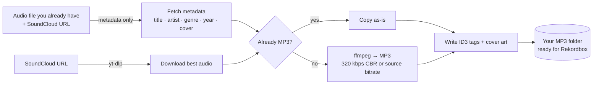

<div align="center">


### SoundCloud track → properly tagged, honestly labelled MP3 → straight into your Rekordbox import folder


</div>

---

**Sound Merge** is a small desktop app that takes care of the boring part of building a DJ library: download or convert, tag, name, and file. You still make playlists, run analysis and set cue points yourself in Rekordbox. Sound Merge only gets clean MP3s into the right folder.

## ✨ Features

- 🎯 **Two flows, one window** – merge a file you already have with its SoundCloud link, or download a rip straight from a URL.
- 🏷️ **Real tags** – title, artist, genre, year and cover art are written as ID3 tags from the track's metadata.
- 🧹 **Clean titles** – promo text like `(Free Download)`, `[FREE DL]` or `Free-Download!` is stripped automatically.
- 📏 **Honest quality** – a file is never upscaled. MP3s are copied untouched, other formats become true 320 kbps CBR MP3, and lossy streams keep their real bitrate.
- 🗑️ **Safe clean-up** – optionally send the source file to the Recycle Bin (recoverable) after a successful merge.
- 🖱️ **Drag & drop** – drop an audio file onto the window or click to browse.
- 🔒 **Single instance guard** – opening a second copy asks whether to run alongside, skip, or close the other one.
- 📝 **Clean log + detailed log** – a short status per job, with the full yt-dlp / ffmpeg output one click away.

## 🔄 How it works



## 🚀 Quick start

**Requirements:** Windows, Python 3.10+, and [ffmpeg](https://ffmpeg.org/download.html) on your `PATH` (`ffmpeg -version` should work in a terminal).

```bash
git clone https://github.com/GitHubuser5o5/sound-merge.git
cd sound-merge
pip install -r requirements.txt
```

Open `config.json` and set `mp3_folder` to the folder you import from in Rekordbox (see [Configuration](#%EF%B8%8F-configuration)), then start the app:

```bash
python gui.py
```

## 🎛️ Using the app

### Flow 1 – Process file + link

Use this for a track you already downloaded yourself (for example from a site that needs a sign-in).

1. Drag the audio file onto the drop zone, or click the zone to browse (it opens in your Downloads folder).
2. Paste the track's SoundCloud URL underneath.
3. Click **Process file + link**.

What happens:

- Metadata (title, artist, genre, year, cover art) is fetched from the URL. **No audio is downloaded from SoundCloud in this flow.**
- If your file is already an MP3 it's copied as-is. Anything else is converted to a true 320 kbps CBR MP3. Your file's real quality is kept, never faked.
- The **Delete original after merge** switch sends the source file to the Recycle Bin after a successful merge. It's off by default and your choice is remembered.
- The fields only clear after a *successful* merge, so a failed attempt can simply be retried.

### Flow 2 – Download 160 kbps rip

1. Paste a SoundCloud URL.
2. Click **Download 160kbps rip**.

Sound Merge downloads, converts and tags the track on its own. Without a logged-in session SoundCloud usually only exposes a streamed preview (about 128–160 kbps) rather than the uploader's original, so the output keeps that real bitrate and is **never upscaled**. If a free-download original happens to be reachable, you get a true 320 kbps encode instead.

### Good to know

- One job runs at a time; the buttons are disabled while a job is running.
- Window size and position are remembered between runs.
- If `wallpaper.jpg` sits next to the app it's used as the background, and the window is locked to the image's aspect ratio so it never stretches. Without it you get a plain dark window.

## ⚙️ Configuration

`config.json` lives next to `gui.py` (or the built exe). Relative paths are resolved from the app's own folder.

| Key | Default | What it does |
| --- | --- | --- |
| `mp3_folder` | `output_mp3` | Where finished MP3s are saved. Point it at your Rekordbox import / watch folder, e.g. `D:/Music/Unsorted`. |
| `queue_file` | `queue.txt` | URL list used by the headless watcher. |
| `done_log` | `done_log.txt` | URLs the watcher has already processed. |
| `temp_dir` | `temp_downloads` | Scratch space for downloads and cover art. |
| `input_folder` | `input_downloads` | Working folder for local-file merges. |
| `poll_seconds` | `5` | How often the watcher checks `queue.txt`. |

**Optional cookies:** if a site needs a signed-in session, export your cookies in Netscape format and save them as `www.beatport.com_cookies.txt` next to the app. The file is passed to yt-dlp and is listed in `.gitignore` so it never ends up in a commit.

## 📦 Building the exe

```bash
pip install pyinstaller
pyinstaller --onefile --windowed --collect-data tkinterdnd2 --collect-data customtkinter --icon "sound merge icon.ico" --name "Sound Merge" gui.py
```

Copy `config.json`, `sound merge logo.png`, `sound merge icon.png` (and optionally `wallpaper.jpg`) next to the finished exe in `dist/`. The app looks for its config, images and working folders next to the exe itself, not in the current working directory.

## 🧪 Tests

```bash
python test_core.py
```

A quick smoke test of the shared helpers: filename sanitising, MP3 pass-through vs. conversion, tagging, duplicate naming, the single-instance lock and settings persistence. Run it before rebuilding the exe.

## 🖥️ Advanced: headless queue watcher

`watcher.py` is a terminal alternative to the **Download 160kbps rip** button. Start it, then paste SoundCloud URLs (one per line) into `queue.txt` and save. Each new URL is downloaded, converted, tagged and filed automatically.

```bash
python watcher.py
```

## 🗂️ Project layout

```
sound-merge/
├── gui.py              # customtkinter app (entry point)
├── core.py             # shared helpers: config, ffmpeg, tagging, locking
├── watch_input.py      # "Process file + link" pipeline
├── watcher.py          # URL → MP3 pipeline / headless queue watcher
├── test_core.py        # smoke tests for core.py
├── config.json         # folder settings
├── requirements.txt
├── Sound Merge.spec    # PyInstaller spec
└── sound merge *.png / *.ico   # logo and icons
```

## ⚖️ Disclaimer

Sound Merge is a personal tool and is not affiliated with SoundCloud, Beatport, Pioneer DJ / AlphaTheta or Rekordbox. Only download and convert music you have the right to use, and follow the terms of the services you use it with.
